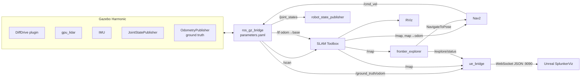

# Architecture

## Goal

Drive a simulated differential-drive robot through an environment it has never seen and build a 2D occupancy map, with nobody steering it. Show the same run in Gazebo (engineering view) and in Unreal Engine 5 (realistic view).

## Packages

| Package | Type | Responsibility |
|---|---|---|
| `robot_splunker_description` | ament_cmake | The robot model (XACRO → URDF): links, joints, geometry, inertia. Gazebo-specific properties (colour, friction, plugins, sensors) live in a separate `robot_splunker.gazebo.xacro`. |
| `robot_splunker_gazebo` | ament_cmake | The worlds (generated), the ROS↔Gazebo bridge config `parameters.yaml`, and `sim.launch.py`. |
| `robot_splunker_bringup` | ament_cmake | System launch files and the parameters for SLAM Toolbox, Nav2 and the explorer. |
| `robot_splunker_exploration` | ament_python | `frontier_explorer`: chooses where to go next and sends Nav2 goals. |
| `robot_splunker_ue_bridge` | ament_python | `ue_bridge_node`: converts state to Unreal coordinates and serves it over a WebSocket. |
| `unreal/SplunkerViz` | UE5 C++ | The digital twin. It connects to `ue_bridge` and only displays (view-only). |

## Data flow



### The control loop

1. Gazebo publishes `/scan` and the odometry transform `odom → base_footprint`. The bridge carries both into ROS.
2. SLAM Toolbox matches each scan against the map it has built so far. It publishes `/map` and the correction `map → odom`.
3. `frontier_explorer` looks for **frontiers** on `/map`: free cells next to unknown cells. It picks the best one and sends Nav2 a `NavigateToPose` goal.
4. Nav2 plans a path (NavFn, with `allow_unknown: true`) and follows it (Regulated Pure Pursuit). The commands pass through the velocity smoother and come out on `/cmd_vel`.
5. The bridge forwards `/cmd_vel` to Gazebo's DiffDrive plugin, which turns the wheels. The loop then repeats.

## TF tree

```
map ──(SLAM Toolbox)──> odom ──(Gazebo DiffDrive via bridge)──> base_footprint
                                                                   └─ base_link (wheel axle)
                                                                       ├─ chassis
                                                                       ├─ left_wheel / right_wheel  (from /joint_states)
                                                                       ├─ caster_link
                                                                       ├─ lidar_link
                                                                       └─ imu_link
```

`robot_state_publisher` publishes everything from `base_footprint` down.

## Design decisions

- **Two launch layers.** `sim.launch.py` is "just the simulator": Gazebo, the spawned robot and the bridges. `explore.launch.py` adds the autonomy stack on top. You can run either one alone.
- **Caster as a fixed, frictionless sphere.** A real swivel caster would need two extra joints, which jitter in simulation and add nothing to mapping. A sphere with `mu = 0` slides in any direction and holds up the front of the robot. This is the usual Gazebo approach.
- **`base_footprint` vs `base_link`.** `base_footprint` sits on the ground and is the frame Nav2 and SLAM use. `base_link` sits at the wheel axle, the point the robot turns about.
- **Nav2 nodes launched directly.** `navigation.launch.py` starts the Nav2 servers itself instead of including `nav2_bringup`. That keeps the node list and the `cmd_vel` wiring explicit and stable across Nav2 releases.
- **Exploring unknown space.** The global costmap keeps unknown cells unknown (`track_unknown_space`), and the planner may route through them (`allow_unknown`). Without both, Nav2 refuses goals at the edge of the map.
- **Frontier explorer in plain numpy.** The algorithm (`frontier_utils.py`) has no ROS dependency, so it can be unit-tested. The node (`frontier_explorer.py`) only does the ROS wiring and the goal state machine.
- **One world, two simulators.** `worlds/<name>.world.yaml` is the single source of truth. `generate_world.py` writes the Gazebo SDF *and* the Unreal layout JSON from it, so the walls line up exactly in both.
- **Unreal is view-only, and uses ground truth.** The UE twin follows Gazebo's *true* pose (`/ground_truth/odom`), so it always matches what Gazebo shows. SLAM's estimate is drawn separately as a blue "ghost", which makes localisation error visible. SLAM and Nav2 never see the ground truth.
- **All coordinate maths in Python.** ROS is right-handed and in metres; Unreal is left-handed and in centimetres. `ue_bridge/coords.py` does every conversion, and its unit tests pin down the handedness. The C++ side never converts anything.
- **UE runs on Windows natively.** UE5's Lumen and Nanite rendering need the native GPU driver. See [unreal_visualization.md](unreal_visualization.md).
